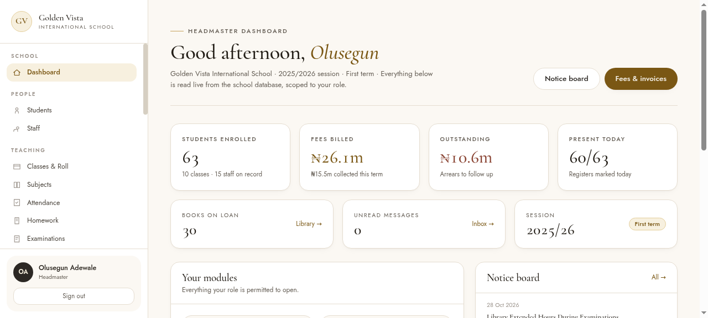

# Golden Vista School Portal

A headmaster's dashboard for a real school — enrolment, fees and arrears, attendance, library loans and whole-school communications in one screen.

**[→ View the live site](https://school-vc7g.vercel.app/)**



## What this is

Before this, fees and attendance were tracked on paper. The goal was a single dashboard the headmaster and staff could use daily — one screen where the state of the school is visible at a glance.

Staff only see what their role allows, so the bursar gets the fee ledger, the class teacher gets attendance, and nobody has to be trusted with more than they need.

## What's inside

- Enrolment and student records
- Fees billed and outstanding arrears
- Daily attendance register
- Library loans
- Whole-school communications
- Role-based access for staff

## Technology

- HTML, CSS and JavaScript
- Static front end with a data layer
- Deployed on Vercel

## Run it locally

No build step, no dependencies — it's plain HTML, CSS and JavaScript.

```bash
# from the repository root
python3 -m http.server 8000
# then open http://localhost:8000
```

Or just open `index.html` directly in a browser.


---

<sub>Built by **[Benito K Chukwuemeka](https://github.com/Ebubechineka)** · [Golden Vista Global](https://goldenvistaglobal.vercel.app/) — business websites, landing pages and web apps for clients in Nigeria and worldwide.</sub>
